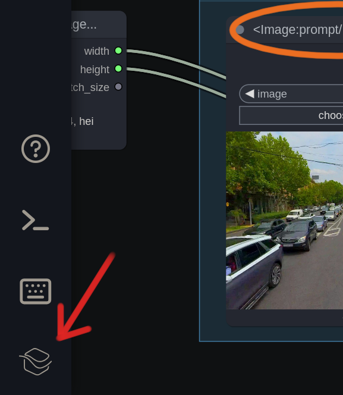

# Minimalistic Comfy Wrapper WebUI v2.x

> [!NOTE]
> Update [v2.4](/Changelog.md#24---minimax-h3-support-update) - added support for Minimax H3, and [example workflows for it](/example_workflows/Readme.md) 🎉

This is a UI extension for [ComfyUI](https://github.com/Comfy-Org/ComfyUI) adding an additional inference focused UI, that dynamically adapts to your workflows - you only need to change the titles of nodes that you want to see in the Minimalistic webui, and click "Refresh" button. Also can work as a standalone server

*More screenshots [here](/docs/moreScreenshots.md)*

You have working workflows inside your ComfyUI installation, but you would want to work with them from a different perspective, simpler for inference, with all the noodles hidden? Want to use it on a phone? You find existing solutions like SwarmUI or ViewComfy too overengineered? So this project is made for you

## Key features:
1. Stability: you don't need to be afraid of refreshing/closing the page - everything you do is kept in browser's local storage (like in ComfyUI). It only resets on the project updates to prevent unstable behavior
1. Work in Comfy and in this webui with the same workflows: you don't need to copy anything or to export in api format. Edit your workflows in Comfy - press "Refresh" button, and see the changes in MCWW
1. Better queues: you can change the order or priority of tasks, pause/resume the queue, and don't worry closing Comfy / rebooting your PC during generations
1. Prompt presets: save your favorite prompts in presets next to the input fields, and retrieve them in 1 click
1. Batch support: match media inputs, batch prompt presets, batch count (seed)
1. Built-in minimalist image editor, that allows you to add visual prompts to image editing model, or crop/rotate the image
1. Mobile friendly UI. You can use it in browser or as PWA app over local network. Read [this](/docs/pwaAndSecureContext.md) for details

Don't hesitate to report any issues. Leave a star ⭐ on GitHub if you like this project

## Installation
*Unfortunately this UI doesn't support python 3.14+, because of the old gradio dependency*

Chose your installation method:

1. [Install as a standalone server](/docs/installation.md#1-install-as-a-standalone-server). Useful if python version or dependencies are incompatible, or if you run ComfyUI in a cloud, or on another PC
2. If your ComfyUI python version <=3.13, and you have ComfyUI Manager, you can [find this extension in the manager](/docs/installation.md#2-installation-from-comfyui-registry)
3. If your ComfyUI python version <=3.13, but you don't find it in the manager, or don't have the manager, you can [install it manually as an extension](/docs/installation.md#3-install-manually-as-an-extension)

If everything is fine, and you've installed it as an extension, you should see this button inside ComfyUI:

*All methods and information about unique environments are described in [INSTALLATION.md](/docs/installation.md)*

## Node titles

You need to mark your input and output nodes with title in special format

- For output nodes (SaveImage/SaveVideo) you need to set `<Result:output:1>` as title, where "Result" is a label displayed in ui, "output" is category and 1 is sort number (if you want to have a specific order for multiply elements). This category is mandatory

- For main inputs you need to use category "prompt", for example `<Positive prompt:prompt:1>` for text prompt or `<Image 1:prompt:1>` for image prompt. This category is mandatory

- Other settings you can bypass using "important", "advanced" or a custom category. Usually for settings you need to use `Primitive` node and connect it to desired widget input.

- For seed you should create `Int` node with title `<Seed:advanced:1>` (🎲, ♻️ buttons)

- For resolution you need to have 2 nodes with "width" and "height" in the title, the rest of the title must be equal (🔃, 📋 buttons)

***Read [TITLES.md](/docs/titles.md) for complete information***

> [!NOTE]
> When you update ComfyUI and workflows break, it can mean it requires re-saving these workflows in ComfyUI, e.g. open them in ComfyUI frontend and press Ctrl+S

The UI also supports tabs, custom accordions, columns and other things. Full information on node titles is available [here](/docs/titles.md)

## Documentation
- [Full installation guide - installation.md](/docs/installation.md)
- [Full node titles info - titles.md](/docs/titles.md)
- [More about other features](/docs/moreAboutOtherFeatures.md)
- [Examples of workflows](/example_workflows/Readme.md)
- [.env file example with all possible variables](/.env.example)
- [Secure context & Install as an app (PWA)</img>](/docs/pwaAndSecureContext.md)

[CHANGELOG](/Changelog.md)

## Roadmap to version 3.0
- ☑️ Recursive None nodes auto deactivation
- Add media presets
- Combo primitives support
- Remake queue and outputs frontend requests using SSE
- Boolean/Dropdown/Radio elements
- App mode support
- Masks support
- Lora name validation

